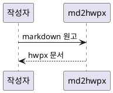

# markdown 문법

기본적으로는 표준 markdown 문법을 따르도록 설계되었으나, 한/글 hwpx의 특수 기능을 표현하기 위해 비표준 markdown 문법도 추가된 부분이 있습니다. 가능하면 비표준 문법은 다음과 같은 마크다운 주석으로 처리합니다.

[표] md2hwpx에서의 hwpx 전용 명령어 사용법

```markdown
<!-- @hwpx 명령어 "인자" -->
```

이 장에서는 본문을 쓰는 문법을 설명하고, 주석으로 쓰는 명령어(주석 마커)는 다음 장에서 하나씩 설명합니다.
각 절은 markdown 원문을 먼저 보이고, 그 아래에 변환된 결과를 보입니다.

## 본문 작성하기

### 제목

줄 맨 앞에 `#` 을 써서 제목을 만듭니다. `#` 의 개수가 제목의 단계이며, 템플릿의 `개요 1` ~ `개요 6` 스타일로 들어갑니다.

```markdown
# 장 제목
## 절 제목
### 항 제목
```

- `#` 하나로 시작하는 제목은 장입니다. 장은 새 쪽에서 시작하고, 표와 그림의 번호는 장마다 1부터 다시 시작합니다.
- 차례에는 `###` 까지 3단계의 제목이 들어갑니다.

### 문단

표준 markdown 문서에서와 같이, 여러 줄로 나눠 써도 한 문단으로 표시됩니다. 단, 문단을 나누고 싶을 때에는 빈 줄을 추가해야 합니다.

이렇게 빈 줄이 추가되면 별도의 문단으로 글이 작성됩니다.
극단적으로
이렇게
써도
한
문단입니다.
그러나 markdown 문서의 가독성을 위해서는 적절히 문장 단위로 나누는 것이 좋습니다.

문단 안에서 줄만 바꾸고 싶으면 줄 끝에 `\` 를 붙입니다.

```markdown
첫째 줄입니다.\
같은 문단의 둘째 줄입니다.
```

첫째 줄입니다.\
같은 문단의 둘째 줄입니다.

### 글자 서식

```markdown
**굵게**, *기울임*, ~~취소선~~, `코드`, [링크](https://example.com)
```

**굵게**, *기울임*, ~~취소선~~, `코드`, [링크](https://example.com)

`*` 나 `[` 같은 기호를 글자 그대로 쓰려면 앞에 `\` 를 붙입니다. 예를 들어 `\*별표\*` 는 \*별표\* 로 들어갑니다.

### 목록

글머리표 목록은 `-` 로, 번호 목록은 `1.` 로 시작합니다. 두 칸(번호 목록 아래는 세 칸)을 들여 쓰면 아래 단계가 됩니다.
목록은 3단계까지 들여 쓰며, 더 깊은 항목은 3단계로 들어갑니다.

```markdown
- 1단계 항목
  - 2단계 항목
    - 3단계 항목
- 1단계 항목

1. 첫째
2. 둘째
   1. 둘째의 첫째
   2. 둘째의 둘째
3. 셋째
```

- 1단계 항목
  - 2단계 항목
    - 3단계 항목
- 1단계 항목

1. 첫째
2. 둘째
   1. 둘째의 첫째
   2. 둘째의 둘째
3. 셋째

글머리표의 모양은 템플릿의 `글머리표 1` ~ `글머리표 3` 스타일이 정합니다.

### 인용문과 수평선

줄 맨 앞에 `>` 를 쓰면 인용문이 되고, `---` 만 있는 줄은 수평선이 됩니다. 수평선의 앞뒤에는 빈 줄을 둡니다.

```markdown
> 인용문은 왼쪽에 선이 그어진 문단으로 들어갑니다.

---
```

> 인용문은 왼쪽에 선이 그어진 문단으로 들어갑니다.

---

### 각주

글 안에 `[^이름]` 을 쓰고, 같은 파일의 다른 줄에 `[^이름]: 내용` 을 쓰면 한/글 각주가 됩니다.
각주 번호는 한/글이 매기므로 이름은 아무 것이나 써도 됩니다. 각주의 내용에는 문단만 쓸 수 있습니다.

```markdown
각주가 달린 문장입니다.[^예시]

[^예시]: 각주의 내용입니다.
```

각주가 달린 문장입니다.[^예시]

[^예시]: 각주의 내용입니다.

### 수식

문장 안의 수식은 다음과 같이 `$`로 감싸서, $E=mc^2$ 처럼 사용할 수 있습니다. 별도의 줄로 표현하고 싶으면 `$$`를 사용할 수 있습니다.

```markdown
문장 안의 수식은 $E=mc^2$ 처럼 씁니다.

$$ x = \frac{-b \pm \sqrt{b^2 - 4ac}}{2a} $$
```

$$ x = \frac{-b \pm \sqrt{b^2 - 4ac}}{2a} $$

- 문장 안의 수식은 `$` 바로 안쪽에 공백이 없어야 합니다. 공백이 있으면 수식이 아니라 글자로 들어갑니다.
- 별도의 줄로 쓰는 수식은 앞뒤에 빈 줄을 둡니다.
- 수식은 LaTeX 문법으로 쓰며, 한/글 수식 개체로 들어가므로 한/글에서 고칠 수 있습니다.
- 분수, 첨자, 루트, 합·적분·극한, 그리스 문자, 행렬 정도는 변환됩니다.

그러나 너무 복잡한 수식은 렌더링에 실패할 수 있습니다. 변환하지 못한 수식은 쓴 그대로 글자로 들어가고 경고가 나오므로, 변환 과정에서 발생하는 로그를 잘 확인해주세요.

## 코드블록

코드는 `` ``` `` 만 있는 줄 사이에 씁니다. 여는 줄에 언어 이름을 쓰면 구문 강조가 적용됩니다.

````markdown
```python
def hello(name):
    print(f"안녕하세요, {name}")
```
````

```python
def hello(name):
    print(f"안녕하세요, {name}")
```

코드블록은 테두리가 있는 상자로 들어가며, 쪽을 넘으면 다음 쪽으로 이어집니다. 이 장의 첫 코드블록처럼 표 제목을 붙일 수도 있습니다.

## 그림

### 그림 넣기

그림은 마크다운의 그림 입력 방식을 그대로 따릅니다. 단, 그림 제목은 `[그림 #링크제목] 그림제목` 형태로 입력하면, [그림 <장번호>-<그림번호>] 그림제목 형태로 그림의 아래쪽에 붙습니다. `[[@링크제목]]` 형태로 언급할 수 있습니다.

```markdown
[그림 #fig:예시] 예시 그림

```

[그림 #fig:예시] 예시 그림


- 그림 파일의 경로는 markdown 파일이 있는 폴더를 기준으로 씁니다.
- PNG, JPEG, GIF 는 그대로 들어가고, SVG, BMP, TIFF, WebP 등은 PNG 로 바뀌어 들어갑니다.
- 그림은 원래 크기로 들어가며, 본문의 폭이나 높이를 넘으면 넘지 않게 줄어듭니다.
- 그림 제목 줄이 없으면 `` 의 그림제목이 제목이 됩니다. 그것도 비어 있으면 제목과 번호가 없는 그림이 됩니다.

[그림 #fig:없는그림] 존재하지 않는 그림


[[@fig:없는그림]] 에서와 같이 잘못된 그림 경로를 입력하면 기본 그림이 들어가고 경고가 나옵니다. 그림 번호는 각 장(`#` 로 시작하는 문단)마다 새로 시작합니다.

### 그림 크기

그림 바로 앞에 `그림크기` 명령어를 쓰면 크기를 정할 수 있습니다. 그림 제목 줄이 있으면 제목 줄과 그림 사이에 씁니다.

```markdown
[그림 #fig:크기] 본문 폭의 절반으로 넣은 그림
<!-- @hwpx 그림크기 너비=50% -->

```

[그림 #fig:크기] 본문 폭의 절반으로 넣은 그림
<!-- @hwpx 그림크기 너비=50% -->


- `너비=` 와 `높이=` 에 `%`(본문의 폭·높이 기준) 또는 `mm` 로 씁니다.
- 하나만 쓰면 다른 쪽은 원래 비율을 따릅니다.

### 다이어그램

`mermaid` 와 `plantuml` 코드블록은 그림으로 바뀌어 들어갑니다. 그림 제목은 다른 그림과 같이 붙입니다.

````markdown
[그림 #fig:mermaid] mermaid 로 그린 흐름도


````

[그림 #fig:mermaid] mermaid 로 그린 흐름도


````markdown
[그림 #fig:plantuml] plantuml 로 그린 순서도
<!-- @hwpx 그림크기 너비=50% -->


````

[그림 #fig:plantuml] plantuml 로 그린 순서도
<!-- @hwpx 그림크기 너비=50% -->


다이어그램은 본문의 폭에 맞춰 들어갑니다. 더 작게 넣으려면 위의 순서도처럼 `그림크기` 명령어를 씁니다.

## 표

### 표 만들기

표는 `|` 로 칸을 나누어 씁니다. 첫 줄이 머리 행이고, 둘째 줄은 머리 행과 내용을 나누는 구분 행입니다.
표 제목은 `[표 #링크제목] 표제목` 형태로 표 앞에 쓰며, 표의 위쪽에 붙습니다.

```markdown
[표 #tbl:기본] 기본 표
| 항목 | 설명 |
| --- | --- |
| 머리 행 | 회색 배경으로 들어가며, 표가 쪽을 넘으면 쪽마다 다시 보입니다. |
| 열 너비 | 내용의 길이에 맞춰 자동으로 나뉩니다. |
```

[표 #tbl:기본] 기본 표
| 항목 | 설명 |
| --- | --- |
| 머리 행 | 회색 배경으로 들어가며, 표가 쪽을 넘으면 쪽마다 다시 보입니다. |
| 열 너비 | 내용의 길이에 맞춰 자동으로 나뉩니다. |

### 열 정렬

구분 행에 `:` 을 넣으면 그 열의 정렬이 정해집니다.

```markdown
[표 #tbl:정렬] 구분 행과 열 정렬
| 구분 행 | 정렬 | 예시 값 |
| :-- | :-: | --: |
| `:--` | 왼쪽 | 1,000 |
| `:-:` | 가운데 | 25,000 |
| `--:` | 오른쪽 | 1,250,000 |
```

[표 #tbl:정렬] 구분 행과 열 정렬
| 구분 행 | 정렬 | 예시 값 |
| :-- | :-: | --: |
| `:--` | 왼쪽 | 1,000 |
| `:-:` | 가운데 | 25,000 |
| `--:` | 오른쪽 | 1,250,000 |

### 열 너비와 칸 안의 줄바꿈

열 너비를 직접 정하려면 표 바로 앞에 `열너비` 명령어를 씁니다. 표 제목 줄이 있으면 제목 줄과 표 사이에 씁니다.
칸 안에서 줄을 바꾸려면 `<br>` 을 씁니다.

```markdown
[표 #tbl:열너비] 열 너비를 정한 표
<!-- @hwpx 열너비 20% 80% -->
| 구분 | 내용 |
| --- | --- |
| 열 너비 | 열마다 표 폭의 비율을 씁니다.<br>값의 개수는 열의 개수와 같아야 합니다. |
| 줄바꿈 | 첫째 줄<br>둘째 줄 |
```

[표 #tbl:열너비] 열 너비를 정한 표
<!-- @hwpx 열너비 20% 80% -->
| 구분 | 내용 |
| --- | --- |
| 열 너비 | 열마다 표 폭의 비율을 씁니다.<br>값의 개수는 열의 개수와 같아야 합니다. |
| 줄바꿈 | 첫째 줄<br>둘째 줄 |

- 칸 안에서도 글자 서식, 링크, 각주, 수식을 쓸 수 있습니다.
- 칸 안에 `|` 문자를 쓰려면 `\|` 로 씁니다.

## 제목과 번호 참조

표, 그림, 코드블록의 제목과 번호는 다음과 같이 붙습니다.

- `[표] 제목` 줄 다음에 표나 코드블록이 오면 그 위쪽에 [표 <장번호>-<표번호>] 제목 형태로 붙습니다.
- `[그림] 제목` 줄 다음에 그림이 오면 그 아래쪽에 [그림 <장번호>-<그림번호>] 제목 형태로 붙습니다.
- 표와 그림의 번호는 따로 세며, 장이 바뀌면 1부터 다시 시작합니다.
- 제목이 없는 표와 그림은 번호를 세지 않고, 표 차례와 그림 차례에도 들어가지 않습니다.

제목 줄을 `[표 #이름] 제목` 처럼 쓰면 그 표에 이름이 붙고, 글 안의 `[@이름]` 이 그 표의 번호로 바뀝니다.
괄호까지 넣으려면 `[[@이름]]` 처럼 씁니다.

```markdown
열 정렬은 [[@tbl:정렬]] 에, 그림 크기는 [[@fig:크기]] 에 예시가 있습니다.
```

열 정렬은 [[@tbl:정렬]] 에, 그림 크기는 [[@fig:크기]] 에 예시가 있습니다.

- 이름에는 공백과 `[`, `]` 를 쓸 수 없습니다. 이 문서에서는 표는 `tbl:`, 그림은 `fig:` 로 시작하게 지었습니다.
- 뒤에 나오는 표와 그림도 참조할 수 있고, 다른 파일(다른 장)의 표와 그림도 참조할 수 있습니다.
- 없는 이름이나 두 번 쓴 이름을 참조하면 글자 그대로 남고 경고가 나옵니다.
- 번호는 변환할 때 정해진 글자입니다. 한/글에서 표나 그림을 더하거나 옮겨도 바뀌지 않으므로, 원고를 고쳐 다시 변환합니다.
- `[표] 제목`, `[@이름]` 같은 표기를 글자 그대로 쓰려면 맨 앞에 `\` 를 붙여 `\[표] 제목`, `\[@이름]` 처럼 씁니다.
