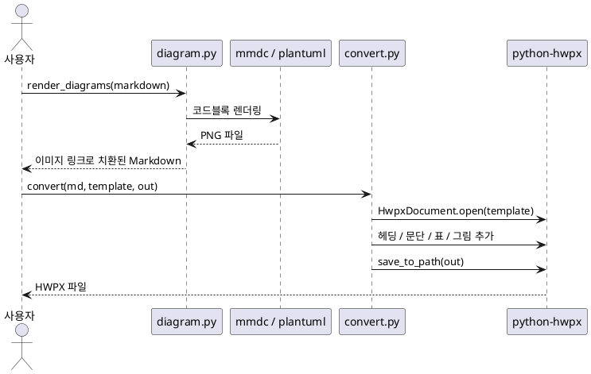
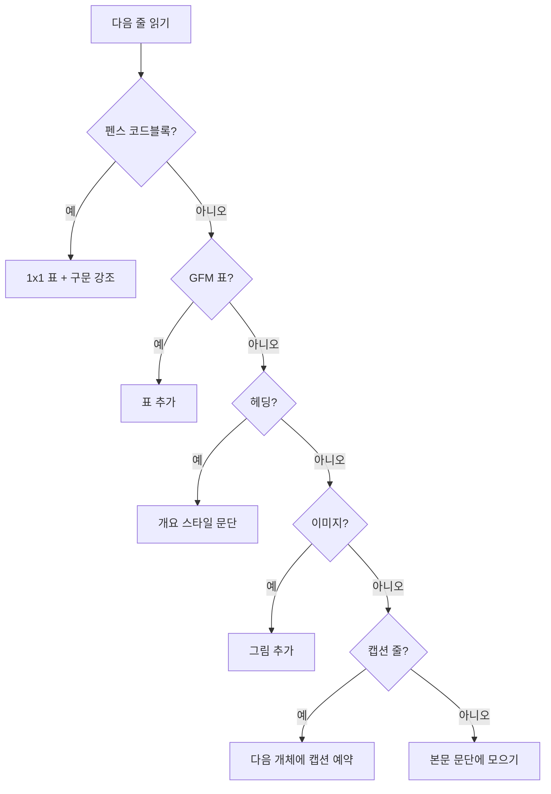

# md2hwpx 소개

md2hwpx 는 Markdown 문서를 한/글 문서 형식인 HWPX 파일로 변환하는 Python 프로젝트입니다.
기술 문서를 Markdown 으로 작성하고 버전 관리하면서, 제출이나 공유가 필요할 때 한/글 문서로 바로 만들 수 있도록 하는 것이 목표입니다.

이 문서 자체가 변환 기능을 시험하는 샘플입니다.
헤딩, 문단, 다이어그램, 표, 그림, 코드블록과 캡션이 모두 들어 있으므로, 변환한 HWPX 파일을 한/글에서 열어 결과를 바로 확인할 수 있습니다.

## 프로젝트 개요

변환은 두 단계로 이루어집니다.
먼저 Markdown 안의 mermaid, plantuml 코드블록을 PNG 이미지로 렌더링하고, 코드블록을 이미지 링크로 바꿉니다.
그다음 템플릿 HWPX 문서를 열어 Markdown 내용을 차례로 추가하고 새 파일로 저장합니다.

HWPX 문서는 `python-hwpx` 라이브러리로 다루며, 글자 모양과 문단 모양은 템플릿에 정의된 스타일을 그대로 사용합니다.
따라서 템플릿만 바꾸면 같은 Markdown 으로 서식이 다른 문서를 만들 수 있습니다.

## 변환 흐름

### 구성 요소 간 상호작용

사용자가 변환을 요청하면 다이어그램 렌더링 모듈과 변환 모듈이 차례로 동작합니다.
다이어그램 렌더링에는 외부 도구인 mermaid-cli 와 PlantUML 을 사용합니다.

[그림] 변환 과정의 시퀀스 다이어그램



### 블록 판별 순서

변환 모듈은 Markdown 을 한 줄씩 읽으며 어떤 블록인지 판별합니다.
먼저 확인하는 규칙이 우선하므로, 코드블록 안에 있는 `#` 으로 시작하는 줄은 헤딩으로 처리되지 않습니다.

[그림] 줄 단위 블록 판별 흐름도



## 지원하는 Markdown 문법

현재 지원하는 블록과 변환 결과는 다음과 같습니다.
문장 안에서는 `인라인 코드`, **굵게**, *기울임*, ~~취소선~~, ***굵은 기울임*** 을 쓸 수 있습니다.
링크는 [python-hwpx 저장소](https://github.com/airmang/python-hwpx) 처럼 한/글 하이퍼링크가 되고, `file_name` 같은 밑줄 단어나 \*별표\* 같은 이스케이프는 글자 그대로 남습니다.
인용문과 수평선은 아직 지원하지 않습니다.

[표] Markdown 블록별 변환 결과

| Markdown 블록 | HWPX 변환 결과 | 적용 스타일 |
|:--|:--|:-:|
| 헤딩 1~6단계 | 개요 문단 | 개요 1 ~ 개요 6 |
| 일반 문단 | 문단 (연속된 줄은 공백으로 연결) | 본문 |
| 이미지 | 그림 개체 | 본문 |
| 표 | 표 개체 (머리 행 굵게, 회색 배경) | 본문 |
| 코드블록 | 1x1 표 (D2Coding, 구문 강조) | 본문 |
| 캡션 줄 | 표·그림 개체의 캡션 | 표그림제목 |
| 목록 | 글머리표·번호 문단 (3수준까지) | 본문 |
| `인라인 코드` | D2Coding 글꼴 글자 조각 | 감싼 문단의 스타일 |
| **굵게**, *기울임*, ~~취소선~~ | 서식이 적용된 글자 조각 | 감싼 문단의 스타일 |
| [링크](https://example.com) | 하이퍼링크 필드 | 감싼 문단의 스타일 |

### 표의 열 정렬

표의 구분 행에 콜론을 넣으면 열 정렬이 적용됩니다.
아래 표는 세 가지 정렬과 기본값을 한 번에 보여 줍니다.

[표] 구분 행 표기와 정렬 결과

| 구분 행 표기 | 정렬 | 예시 값 |
|:--|:-:|--:|
| `:--` | 왼쪽 | 1,000 |
| `:-:` | 가운데 | 25,000 |
| `--:` | 오른쪽 | 1,250,000 |
| `---` | 템플릿 기본값 | 0 |

### 캡션 규칙

표나 코드블록 바로 앞에 [표] 로 시작하는 줄을, 그림 바로 앞에 [그림] 으로 시작하는 줄을 쓰면 캡션이 됩니다.
캡션에는 문서 순서대로 번호가 붙고, 표 캡션은 표 위에, 그림 캡션은 그림 아래에 들어갑니다.
캡션 줄과 개체 사이에는 빈 줄이 있어도 됩니다.

#### 번호 매기기

표와 코드블록은 같은 번호 체계를 쓰고, 그림은 따로 번호를 셉니다.
캡션이 없는 개체는 번호를 세지 않습니다.

##### 번호의 한계

번호는 변환할 때 고정된 글자로 들어갑니다.
한/글에서 표나 그림을 추가하거나 지워도 번호는 자동으로 바뀌지 않습니다.

###### 참고

한/글의 자동 번호를 쓰려면 캡션 안에 번호 필드를 직접 넣어야 하는데, python-hwpx 에는 아직 이를 위한 공개 기능이 없습니다.

### 목록

글머리표 목록과 번호 목록은 한/글의 글머리표·번호 문단으로 바뀝니다.
하위 목록은 3단계까지 들여쓰며, 번호는 한/글이 자동으로 매깁니다.

- 글머리표 목록은 `-`, `*`, `+` 로 시작합니다
- 하위 목록은 상위 항목의 내용 위치만큼 들여씁니다
  - 2단계 항목입니다
    - 3단계 항목입니다
- 항목 다음 줄에 이어 쓴 내용은
  같은 항목으로 합쳐집니다

번호 목록은 첫 항목의 숫자부터 번호를 매깁니다.

1. 다이어그램을 PNG 로 렌더링합니다
2. 템플릿 HWPX 를 엽니다
   1. 헤딩과 문단을 추가합니다
   2. 표와 그림을 추가합니다
3. 새 HWPX 파일로 저장합니다

## 템플릿 스타일

템플릿 HWPX 에는 다음 스타일이 있어야 합니다.
스타일은 번호가 아니라 이름으로 찾으므로, 템플릿에서 스타일 순서가 바뀌어도 변환에는 영향이 없습니다.

[표] 템플릿에 필요한 스타일

| 스타일 이름 | 용도 |
|---|---|
| 개요 1 ~ 개요 6 | Markdown 헤딩 |
| 본문 | 헤딩을 제외한 본문 문단, 표와 그림을 담는 문단 |
| 표그림제목 | 표, 그림, 코드블록의 캡션 |

## 그림 삽입

이미지 경로는 Markdown 파일이 있는 폴더를 기준으로 찾습니다.
그림은 python-hwpx 의 기본 폭으로 들어가며, 원본 비율을 유지합니다.

[그림] 샘플 그라데이션 이미지


## 사용 방법

### Python 에서 호출하기

다이어그램을 먼저 렌더링한 뒤 변환합니다.
`convert` 함수는 이미지 경로를 Markdown 파일 위치 기준으로 찾으므로, 렌더링 결과는 원본과 같은 폴더에 저장합니다.

[표] `render_diagrams` 후 `convert` 로 변환하는 예제

```python
from pathlib import Path

from md2hwpx.convert import convert
from md2hwpx.diagram import render_diagrams

doc = Path("docs/guide.md")
markdown = render_diagrams(
    doc.read_text(encoding="utf-8"),
    out_dir=doc.parent / "images",
    link_base=doc.parent,
)
rendered = doc.with_name("guide.rendered.md")
rendered.write_text(markdown, encoding="utf-8")

convert(rendered, Path("template.hwpx"), doc.with_suffix(".hwpx"))
```

### Docker 로 실행하기

다이어그램 렌더링에는 mermaid-cli, Chromium, Java, PlantUML 이 필요합니다.
이 도구들을 모두 담은 Docker 이미지를 제공하며, 프로젝트 폴더를 컨테이너에 마운트해서 실행합니다.

[표] Docker 이미지 빌드와 테스트 실행 명령

```sh
docker build -t md2hwpx .

# 호스트 사용자 권한으로 테스트 실행
docker run --rm --user "$(id -u):$(id -g)" -v "$PWD":/work md2hwpx \
    pytest -q -p no:cacheprovider
```

### 구문 강조

코드블록의 펜스 뒤에 언어 이름을 쓰면 Pygments 로 구문 강조가 적용됩니다.
언어를 쓰지 않거나 Pygments 가 모르는 이름이면 강조 없이 기본 글자색으로 들어갑니다.
아래 코드블록은 언어를 지정하지 않았으므로 강조되지 않습니다.

```
md2hwpx/
├── src/md2hwpx/    소스 코드
├── tests/          pytest 테스트
├── spec/           구현 스펙 문서
├── samples/        변환 테스트용 샘플
└── template.hwpx   변환에 사용하는 템플릿
```
