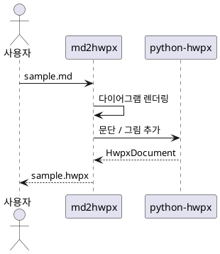
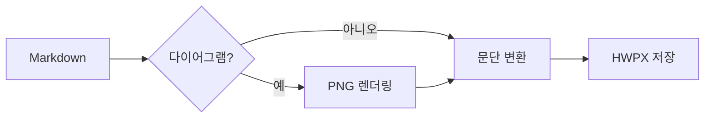

# 헤딩 1

헤딩 1 아래의 본문 문단입니다.
같은 문단의 둘째 줄입니다.

## 헤딩 2

헤딩 2 아래의 본문 문단입니다.

### 헤딩 3

헤딩 3 아래의 본문 문단입니다.

#### 헤딩 4

헤딩 4 아래의 본문 문단입니다.

##### 헤딩 5

헤딩 5 아래의 본문 문단입니다.

###### 헤딩 6

헤딩 6 아래의 본문 문단입니다.

# 다이어그램

## PlantUML

[그림] PlantUML 시퀀스 다이어그램



## Mermaid

[그림] Mermaid 흐름도



# 표

[표] 변환 항목

| 항목 | 설명 | 비고 |
|------|------|-----:|
| 헤딩 | 개요 스타일로 변환 | 1 |
| 문단 | 본문 스타일로 변환 | 2 |
| 그림 | 이미지로 삽입 | 3 |

# 그림

[그림] 샘플 그림


# 코드

[표] 인사 함수

```python
def hello(name: str) -> str:
    return f"안녕하세요, {name}"
```
